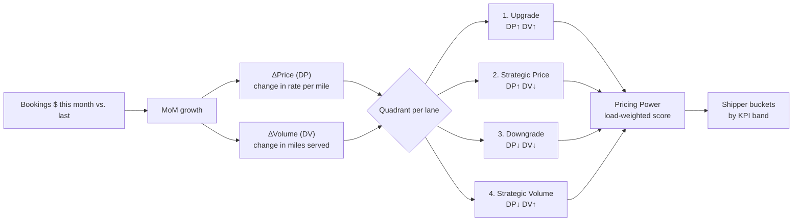

# Pricing Power: Price vs. Volume Analytics for Freight Brokerage in Power BI

A Power BI model that answers a question every brokerage pricing team gets asked: ***was this month's growth bought with discounts, or earned with pricing power?***

Each month's bookings growth is split into a **price effect** (rate per mile) and a **volume effect** (miles served). Every lane is then placed in one of four quadrants, and the result is rolled up into a single, weighted **Pricing Power** score that can be tracked company-wide, by sales team, equipment, quoting channel, shipper or lane.

> The data is a real, frozen snapshot (Jan 2022 – Jun 2024) of a US freight brokerage's spot truckload business, with **every shipper name and ID replaced by a fictional one**. See [Data & anonymization](#data--anonymization).

---

## What's inside

| Path | What it is |
|---|---|
| `Pricing Power.pbip` | Power BI Project: open this in Power BI Desktop |
| `Pricing Power.SemanticModel/` | The semantic model (`model.bim`): 9 tables, 89 DAX measures |
| `Pricing Power.Report/` | The report: 15 pages |
| `Data/` | Parquet snapshots of every source table (≈ 1 M rows) |
| [`docs/methodology.md`](docs/methodology.md) | The maths: price/volume decomposition, quadrants, KPI, buckets, lane scores |
| [`docs/data-model.md`](docs/data-model.md) | Tables, keys and relationships |
| [`docs/report-pages.md`](docs/report-pages.md) | Page-by-page guide to the report |

## Quick start

1. Install [Power BI Desktop](https://powerbi.microsoft.com/desktop) (2.132 / Aug 2024 or later). If it can't open `.pbip` files, enable *Options → Preview features → Power BI Project (.pbip) save option*.
2. Clone the repo to `C:\Pricing-Power`:
   ```bash
   git clone https://github.com/kauemelo01/Pricing-Power.git C:\Pricing-Power
   ```
   If you clone it anywhere else, open *Transform data → Manage parameters* and point **`DataFolder`** at your `Data\` folder (keep the trailing backslash).
3. Open `Pricing Power.pbip` and click **Refresh**. The repo doesn't ship the data cache, so the first refresh loads everything from `Data/`.

The *Big Figures* page uses one AppSource visual, *Box and Whisker by MAQ*. Power BI Desktop downloads it automatically the first time the report opens.

---

## How the model works



### 1. Split growth into price and volume

Bookings are rate per mile × miles, so month-over-month growth factors exactly:

```
(1 + MoM) = (1 + DP) · (1 + DV)
DP = RPM this month / RPM last month − 1        (price effect)
DV = miles this month / miles last month − 1    (volume effect)
```

Two audit measures (`sanity_check_m`, `sanity_check_r`) check that this identity holds in every cell. Movements smaller than ±0.2% are treated as zero, so noise doesn't flip a lane between quadrants.

### 2. Put every lane in a quadrant

For a single KMA lane (Key Market Area → Key Market Area) in a given month:

| | **DV > 0** (more miles) | **DV ≤ 0** (fewer miles) |
|---|---|---|
| **DP > 0** (higher rate) | **1. Upgrade**: growing and getting paid more | **2. Strategic Price**: trading volume for rate |
| **DP ≤ 0** (lower rate) | **4. Strategic Volume**: buying volume with price | **3. Downgrade**: losing both |

Upgrade lanes are further split by **sourcing spread**: *winning* (the brokerage made money on the loads) vs. *losing*.

### 3. Roll it up into one number

The **Pricing Power** score is a load-weighted average of quadrant scores:

| Quadrant | Weight |
|---|---:|
| 1a. Upgrade & winning | +2 |
| 1b. Upgrade & losing | +1.5 |
| 2. Strategic Price | +1 |
| 4. Strategic Volume | +1 |
| 3. Downgrade | −1 |

```
KPI = Σ(loads in quadrant × weight) / Σ(loads in all quadrants)
```

A KPI of **100%** means the average load sat on a lane holding its ground. **Above 100%** means growth came with price. **Below 0%** means most volume sat on lanes losing both rate and miles. All weights and thresholds are measures in the `Parameters` folder, so they can be tuned in one place.

### 4. Many lenses on the same KPI

| Variant | What it fixes |
|---|---|
| `KPI` | Follows every filter: lane, shipper, month… |
| `Pricing Power` | Keeps only year, month, equipment, sales team and quoting method; ignores lane/shipper selections, for stable trend lines |
| `KPI (Company-Wide)` | Account + Enterprise sales, by month only; the benchmark line on every chart |
| `KPI (Shipper Specific)` | Only when exactly one shipper is in context; used to bucket shippers |

Shippers are then grouped into **KPI buckets**: below 0%, 0–100%, exactly 100%, 100%–167%, above 167%, or blank. The report shows how much **bookings** or **sourcing spread** sits in each bucket, chosen with a slicer.

### 5. Lane dynamics and health

- **Quadrant volatility**: how often a lane changes quadrant from one month to the next (`# Changes ÷ (# Months − 1)`). Stable lanes show a durable pricing position.
- **Lane Score (A–F)**: sourcing-spread health this month vs. last month. A = above +5% both months, F = below −3% both months.
- **Conversion**: loads ÷ quotes on the same lane, month, equipment and quoting channel, plus a trailing-12-month version.

Full definitions: [docs/methodology.md](docs/methodology.md).

---

## Data & anonymization

| Table | Rows | Content |
|---|---:|---|
| Main | 47 k | Monthly booked spot FTL loads (dry van, flatbed, reefer) by shipper, KMA lane, equipment and quoting method: bookings, miles, sourcing spread, markup over estimated cost |
| Quoting | 975 k | Monthly quote counts by lane, equipment, quoting method |
| Carriers | 9 k | Distinct carriers per lane in the trailing 12 months |
| Shippers | 2.9 k | Shipper dimension: sales team, industry subgroup |
| List | 7.3 k | The lane universe: KMA lanes whose RPM falls inside outlier fences |

The snapshot covers **2022-01 to 2024-06**: 89 k loads and $185 M in bookings across 6 k KMA lanes. It includes a small number of manual corrections the pricing team applied on top of the warehouse extract. The original warehouse and spreadsheet connections were replaced with local Parquet files, so the project runs fully offline.

**Anonymization:**
- All **2,878 shipper names** were replaced with fictional ones ("Nervous Noodle Industries").
- All **shipper IDs** were replaced with random 9-digit numbers, consistently across tables, so every relationship and measure behaves exactly as on the original data.
- Lanes are expressed as city/state and KMA pairs, and carriers only appear as counts.

## Tech notes

- Power BI Project format (PBIP) with a TMSL model (`model.bim`).
- All logic is DAX. Month-over-month comparisons use explicit `year`/`month` arithmetic instead of time intelligence, so they work on a plain `year-month` grain without a date table.
- `Amounts` is a two-row disconnected table that works like a field parameter: one slicer switches every bucket visual between bookings and sourcing spread.
- The sibling project [elasticity-wsb](https://github.com/kauemelo01/elasticity-wsb) covers the price-elasticity side of the same business. Shippers that appear in both datasets carry the same fictional name in both repos.
