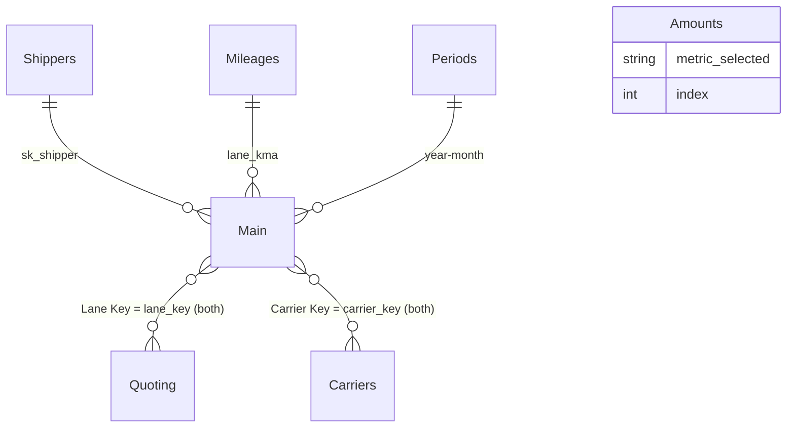

# Data model

A single fact table, **`Main`**, with quotes, carrier counts and shipper attributes joined through composite text keys. Three calculated tables provide lookups.



`Amounts` is intentionally **disconnected**: it only drives the bookings ↔ sourcing-spread switch in `Total Amount $`.

## Keys

| Key | Built as | Joins |
|---|---|---|
| `Main[Lane Key]` / `Quoting[lane_key]` | `year-month: lane_kma : equip_type - quoting_method` | conversion (loads ÷ quotes) at matching grain |
| `Main[Carrier Key]` / `Carriers[carrier_key]` | `equip_type : lane_kma` | trailing-12-month carrier counts |
| `sk_shipper` | integer (anonymized) | shipper name, sales team, subgroup |

`Main[shipper_name]` and `Main[sales_team]` are calculated columns (`RELATED(Shippers[…])`), so they can be used directly as slicers on the fact table. `mileage_group` and `Display? (Y/N)` likewise use `RELATED` over the `Mileages` and `Periods` relationships.

**Why Quoting and Carriers filter in both directions:** selecting a lane, month or channel on `Main` has to narrow the quotes and carrier counts used in `Conversion %` and `# Unique Carriers`. Both keys repeat on both sides (one row per shipper on `Main`), so these are many-to-many joins.

## Tables

### `Main` (fact)

One row per year × month × shipper × KMA lane × equipment × quoting method. Scope: spot-market FTL, equipment DRV (dry van), FBE (flatbed) and RFR (reefer), non-cancelled, bookings ≥ $300 and more than 1 mile per load, from Jan 2022. Rows are limited to the lanes in `List`, and the pricing team's manual adjustments are appended.

| Column | Description |
|---|---|
| `year`, `month`, `year-month` | booking month (`year-month = year*100 + month`) |
| `quoting_method` | `Manual` or `Automated` |
| `sk_shipper` → `shipper_name`, `sales_team` | shipper (fictional) and owning sales team |
| `equip_type` | DRV / FBE / RFR |
| `lane_kma`, `lane` | KMA lane and city lane (`ORIGIN -> DESTINATION`) |
| `kma_origin_prefix`, `kma_destiny_prefix` | two-letter state prefix of each KMA |
| `lane_origin`, `lane_destiny` | city-lane ends |
| `bookings`, `mileage`, `loads` | revenue ($), miles, load count |
| `ss_base` | gross sourcing spread ($) |
| `markup_ecoh`, `original_ecoh` | markup over, and value of, the estimated cost of haul ($) |
| `extra_charges` | accessorial charges billed to the shipper ($) |
| `rpm_line`, `mileage_line` | row-level RPM and miles per load (calculated) |
| `mileage_group` | distance band from `Mileages` (calculated) |
| `Display? (Y/N)` | `N` for months under $1 M bookings (calculated, filtered report-wide) |

### `Quoting`

Monthly quote counts (`quotes`) by `year`, `month`, `quoting_method`, `lane_kma`, `lane`, `equip_type`.

### `Carriers`

`no_carriers`: distinct carriers that moved a load on the lane × equipment in the 12 months before the snapshot.

### `Shippers`

`sk_shipper`, `shipper_name` (fictional), `sales_team`, `shipper_subgroup` (industry).

### `List` (hidden)

The lane universe: `lane_kma`, `equip_type` and the lane's overall `rpm`. Only lanes whose RPM falls inside the outlier fences are kept (see [methodology](methodology.md#9-supporting-metrics)).

### Calculated tables

| Table | Definition | Purpose |
|---|---|---|
| `Mileages` | `SUMMARIZE(Main, lane_kma, "raw_mileage", miles ÷ loads)` | average haul length per lane → `mileage_group` |
| `Periods` (hidden) | monthly bookings of Account + Enterprise sales | `Display?` flag and trailing-12-month anchor |
| `Amounts` (hidden) | 2 rows: *Bookings $* (1), *Sourcing Spread Base $* (2) | metric switch |
| `DateTableTemplate_…` | Power BI auto date/time template (unused) | |

## Data refresh

Each source table is a Power Query that reads a Parquet file from the **`DataFolder`** parameter:

```m
let
    Source = Parquet.Document(File.Contents(DataFolder & "Main.parquet")),
    #"Changed Type" = Table.TransformColumnTypes(Source, {{"equip_type", type text}, …})
in
    #"Changed Type"
```

The files are a frozen snapshot of the original warehouse and spreadsheet extracts, with shipper names and IDs anonymized (see the [README](../README.md#data--anonymization)).
